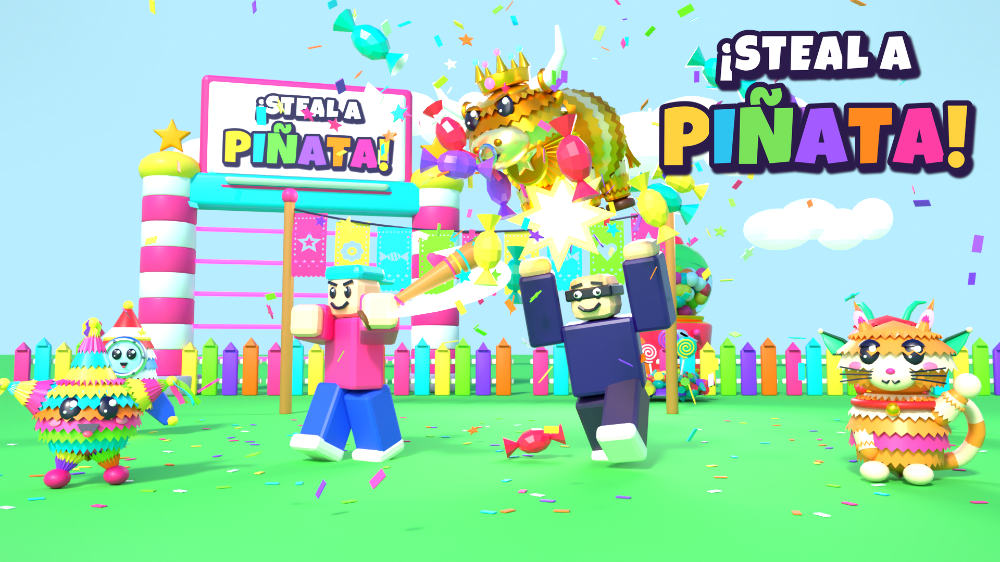

# Steal a Piñata! — Fase 1

| Qué | Dónde |
|---|---|
| Diseño completo (GDD, español) | `plan/GDD.md` |
| Temporada Meme 1 (tendencias, chiste, rareza) | `plan/TRENDS_MEMES.md` |
| Dirección de arte | `art/ART_DIRECTION.md` |
| Cómo importar a Roblox Studio | `art/IMPORT_GUIDE.md` |
| Triángulos por malla | `art/export/TRIANGLES.md` (`candy_pile` 4,562; `lobby_shop_cajas` 20,552, sobre el límite de 20K) |
| Assets para Roblox (.fbx + .obj) | `art/export/{creatures,base,props,lobby}/` |
| Texturas (paleta, papel picado, logo, pisos de plaza) | `art/textures/` y `art/textures/plaza/` |
| Fuentes Blender (.blend) | `art/blend/` |
| Scripts que generan TODO el arte | `art/scripts/` (`plib.py` = librería; `creatures.py`, `props.py`, `base.py`, `lobby.py`, `hero.py`, `lineup.py`, `memes.py`, `lineup_memes.py`, `label_memes.py`, `plaza_tex.py`) |
| Renders (plaza v2 y lineup meme) | `art/renders/` (`lobby_hub.png`, `lobby_hub_street.png`, `lobby_hub_topdown.png`, `lineup_memes.png`) |
| Proyecto Roblox (Rojo) | `roblox-project/` |
| Cómo probar la semana 1 en Studio | `roblox-project/TESTING.md` |
| Cómo probar el loop (bases, robo, bate, candado) | `roblox-project/PLAYTEST.md` |

Regenerar un asset: `cd art/scripts && blender -b --factory-startup -P creatures.py -- toro` (Blender 4.2).
