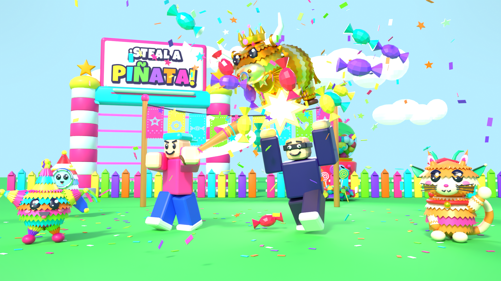
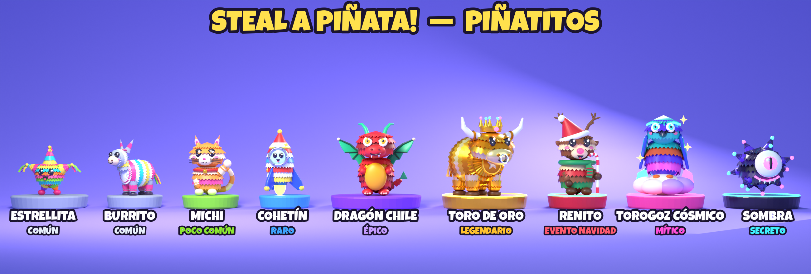
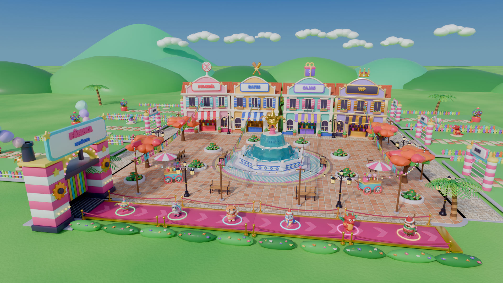

# Steal a Piñata! — Game Design Document (Fase 1)

> Versión 0.1 · 22 oct 2026 · Autor: Marvin Zavala (con apoyo de Grok Bot)
> Estado: **pre-producción terminada.** Ya están listos el arte base de la fase 1 (9 piñatas, base, props y key art), el arte de la fase 2 (**Plaza v2** con los módulos de `art/export/lobby/` y **Temporada Meme 1** con 6 piñatas nuevas) y el esqueleto Rojo. Siguiente paso: programar (sección 13).
>
> **Regla del documento:** todo número de mercado lleva su fuente (sección 17). Los números de diseño (precios en Dulces, probabilidades, tiempos) **son valores iniciales míos para balancear con telemetría**. No son datos.



---

## 0. Resumen en 30 segundos

**Steal a Piñata!** es un juego del género "Steal a ___" (comprar criaturas que generan dinero, defender tu base y robar las de otros) con tres diferencias que se ven en el thumbnail y en 10 segundos de video:

1. **Piñatas con personalidad propia.** Son criaturas de papel crepé con flecos, caras kawaii y un toque latino (Torogoz, Pupusita, Volcán Izalco, Tamalito), todo 100% original.
2. **El robo tiene contrajuego.** Quien carga una piñata va lento, y cualquiera lo puede **bajar a batazos** para que la piñata regrese sola a casa. Ese es el momento TikTok.
3. **Justo desde el día 1.** Movimiento validado por el servidor (Server Authority), servers por liga, escudo de novato, cero pérdidas mientras estás offline y servidores privados baratos. Esto ataca de frente las quejas reales de los jugadores de *Steal An Egg* (hackers, veteranos que aplastan a los nuevos, sin servers privados) [F1][F2][F3].

**Meta de lanzamiento:** viernes **4 de diciembre de 2026**, con el evento navideño "Posadas Piñateras" (sección 11).

---

## 1. Pilares de diseño

| Pilar | Qué significa en la práctica | Cómo se mide |
|---|---|---|
| **¡PUM! se siente bien** | Cada batazo, compra o robo lleva confeti, sonido, cámara y números que saltan. Nada pasa "en silencio". | Clips grabables en playtests; % de jugadores que usan el bate en la primera sesión |
| **Justo para el nuevo** | Escudo de novato, ligas y base protegida offline. El veterano no puede arruinarle la primera hora a nadie. | first-play bounce rate, D1 [F7] |
| **Siempre pasa algo** | La Pasarela con piñatas en vivo, una Fiesta cada 30 min y piñatas nuevas cada semana. | Sesión promedio, D2-7 |
| **Original y latino sin estereotipo** | Folklore, comida y fauna centroamericana con humor universal. UI en inglés, español y portugués. | Cero assets de terceros; CTR del thumbnail |
| **Servidor manda** | El cliente solo pide ("quiero robar esta"). El servidor decide todo. | Exploits reportados por cada 1K DAU |

---

## 2. Público y plataforma

- **Edad principal:** 9 a 15 años (público típico del género). Hay que diseñar para jugar **sin chat**, porque el chat ahora pide verificación de edad [F12]. Se usan emotes y pings rápidos.
- **Plataforma:** móvil primero (botones grandes y pocas partes), después PC y consola.
- **Idiomas:** inglés (base), español y portugués con LocalizationTable desde la semana 1.

---

## 3. Core loop

```
 ┌─────────────── LA PASARELA (alfombra) ───────────────┐
 │ las piñatas desfilan → [Comprar con Dulces]           │
 └──────────────┬────────────────────────────────────────┘
                ▼
     TU BASE: la piñata camina sola a un pedestal libre
                ▼
     Genera Dulces/seg → se acumulan en tu DULCERÍA (generador)
                ▼
     Recolectás → comprás piñatas mejores / mejoras / Re-Fiesta
                ▲                                   │
                │        ROBAR / DEFENDER           ▼
     Bajar ladrones a batazos ◄── Entrar a otra base y cargar su piñata
     Candado láser con cooldown      (vas lento; si te pegan, la soltás)
```

**Loop de 30 segundos:** ver la Pasarela → comprar → ver tu contador subir.
**Loop de 5 minutos:** juntar para la siguiente rareza, defender tu base y robar cuando el candado de otro se apaga.
**Loop de sesión (20 a 30 min):** Fiesta cada 30 min, misiones diarias y Re-Fiesta.
**Loop de semana:** piñata nueva o mutación nueva, liga semanal y Piñatadex.

### 3.1 Acciones del jugador
| Acción | Input móvil / PC | Validación de servidor (resumen) |
|---|---|---|
| Comprar en Pasarela | ProximityPrompt "Comprar" | Distancia ≤ 12 studs, Dulces suficientes, pedestal libre |
| Recolectar | Pisar la plataforma de la Dulcería | El dueño está dentro de su zona de base |
| Robar | Prompt "Robar" (hold 0.6 s) en una piñata ajena | Base ajena sin candado, distancia ≤ 8, no cargás otra cosa, no tenés escudo de novato |
| Batear | Tap / click (tool) | Cooldown 0.8 s, distancia ≤ 9, ángulo frontal ≤ 70° |
| Activar candado | Botón en tu puerta | Sos el dueño y el cooldown terminó |
| Soltar en tu base | Entrar a tu zona cargando | Overlap de zona calculado en el servidor |

---

## 4. Sistemas

### 4.1 La Pasarela (spawner)
- Una alfombra magenta cruza el frente de la plaza (ver `art/renders/lobby_hub.png`). Sale una piñata cada **4 s** desde el arco **FÁBRICA** y tarda unos **40 s** en cruzar.
- Cada piñata muestra flotando su nombre, su rareza (aro neón de color), su precio y sus Dulces/s.
- Si nadie la compra, se mete al arco de salida.
- **Anuncio global** cuando sale Legendaria o mejor ("¡Toro de Oro en la Pasarela!") con 5 s de aviso previo para generar carreras.
- Pesos iniciales por spawn: Común 62%, Poco común 25%, Rara 9%, Épica 3%, Legendaria 0.8%, Mítica 0.19%, Secreta 0.01%. La **Suerte de Server** (producto, sección 9) duplica todo lo que va de Rara para arriba durante 15 min, **para todo el server**.

### 4.2 Base / Patio
- Cada jugador recibe una base de las 6 a 8 que rodean la plaza (ver `lobby_hub_topdown.png`). Tiene piso, puerta-arco con láser, candado, Dulcería (generador), cerca y pedestales.
- **Pedestales:** empezás con 4 y comprás hasta 8 con Dulces. Re-Fiesta desbloquea un 2° piso (hasta 12).
- **Dulcería:** acumula los Dulces de todos tus pedestales. Recolectás pisando su plataforma. Tiene **tope** (mejorable) para obligarte a volver a casa, que es justo cuando te pueden robar.
- **Base offline:** cuando salís, tus piñatas se guardan y **nadie las puede robar**. Las ganancias offline son 50% del ritmo normal, con tope de 8 h.

### 4.3 Robo y carga
- Al robar, la piñata se suelda a la espalda del ladrón y su WalkSpeed baja **de 16 a 11** (la cambia el servidor). Además lleva un **marcador visible para todo el server** y un rastro de confeti.
- Para soltarla tiene que entrar a su propia base. Si en el camino recibe **1 batazo** (2 si es Legendaria o mejor), la suelta y la piñata **regresa sola** caminando a su dueño, protegida por 3 s.
- Anti-frustración: después de que te roban, tu base recibe 20 s de candado automático gratis. Además, **nadie te puede robar más de 2 veces en 5 min.**

### 4.4 Bates (combate)
- Todos empiezan con el **Bate de Madera**: empuja y aturde 1.5 s.
- Las mejoras se ganan jugando (Re-Fiesta / Dulces) y suben la distancia del empujón, no el daño. **No hay vida ni muertes.** El golpe nada más tumba, empuja y hace soltar la piñata.
- Los skins con Robux (Bate de Oro, etc.) son **solo cosméticos** y tienen las mismas stats.

### 4.5 Candado láser
- Activás el candado en tu puerta y se prende un láser de 30 s (VIP suma 10 s) que nadie puede cruzar. Después tiene un cooldown de 60 s.
- Re-Fiesta sube la duración en +5 s por nivel, hasta un máximo de 60 s.
- El HUD muestra el candado de las bases cercanas con un anillo de color, para que el robo sea **estratégico** ("se le apaga en 3, 2, 1...").

### 4.6 Fiesta (evento cada 30 min)
- Durante 3 min **llueven piñatas salvajes** en la plaza (sin dueño). Las rompés a batazos y sueltan Dulces y, a veces, una piñata para tu base.
- Al final aparece la **Piñata Gigante** en la fuente. Es un golpe **cooperativo**: todo el server la rompe junto y todos reciben un premio según su participación. Es el equivalente a los eventos "Admin Abuse" que sostienen a Steal a Brainrot [F5].

### 4.7 Fusión y mutaciones ("Romper para mejorar")
- **Mutaciones:** Dorada (x2 Dulces/s), Arcoíris (x5) y Navideña (x3, solo en el evento). Pueden salir en la Pasarela (Dorada 3%, Arcoíris 0.3%) o por Fusión.
- **Fusión en la Dulcería:** rompés 3 piñatas iguales y sale 1 de la misma especie con una mutación garantizada (Dorada, o Arcoíris con 10%). Es un sumidero de piñatas repetidas y da un momento de "romper" en cámara lenta.

### 4.8 Re-Fiesta (rebirth)
- Requisito: tener ciertas piñatas en tu base (p. ej. Re-Fiesta 1 pide 1 Épica y 500K Dulces).
- Reinicia Dulces, piñatas y pedestales comprados. Da a cambio **+0.5x multiplicador permanente**, +5 s de candado, un bate nuevo y un piso extra (en Re-Fiesta 3).
- Las piñatas **Secretas y de Evento se conservan** para que nadie sienta que perdió lo especial.

### 4.9 Piñatadex
Es un álbum de colección por set (Clásicas, Comida, Fauna, Folklore, Navidad). Cada set completo da un título, un trail o un aumento pequeño de Dulces (+5%). Es el motivo de largo plazo para seguir coleccionando.

### 4.10 Ligas y escudo de novato
- **Escudo de novato:** los primeros 15 min de juego total, nadie te puede robar y vos tampoco podés robar. Se ve como una burbuja de confeti.
- **Ligas:** el matchmaking manda a cada jugador a servers de su rango de "Poder de Base" (suma de Dulces/s): Liga Confeti (0 a 2K/s), Liga Serpentina (2K a 100K/s) y Liga Fuego (100K/s en adelante). Arrancamos con 2 ligas y sumamos la tercera cuando haya CCU suficiente (por eso conviene tener un fallback a servers mixtos si una liga está vacía).

---

## 5. Roster de Piñatitos (23 de fase 1 + 6 Temporada Meme 1)

✅ = modelada en Blender y exportada (`art/export/creatures/`). ⏳ = planeada (brief de arte incluido).
**Dulces/s** = producción base sin multiplicadores. **Precio** = costo en la Pasarela (en Dulces).



| # | Piñata | Rareza | Estado | Visual (silueta + detalle clave) | Dulces/s | Precio | Set |
|---|---|---|---|---|---:|---:|---|
| 1 | **Estrellita** | Común | ✅ | Estrella clásica de 5 picos con conos de flecos de colores, panza redonda, pies de pompón y serpentinas | 1 | 15 | Clásicas |
| 2 | **Pollito Pío** | Común | ⏳ | Bolita amarilla de flecos, pico naranja, 3 plumitas en la cabeza y patitas de pompón | 2 | 40 | Fauna |
| 3 | **Burrito** | Común | ✅ | El burro de piñata de siempre, gordito y medio dormido, con flecos gris-lila y florecita | 3 | 75 | Clásicas |
| 4 | **Sandía Sonriente** | Común | ⏳ | Rebanada triangular con cáscara verde de flecos, semillas-ojos y sonrisa grande | 5 | 150 | Comida |
| 5 | **Michi** | Poco común | ✅ | Gato naranja sentado, cara presumida, una pata saludando y cola rayada | 9 | 350 | Fauna |
| 6 | **Elotito** | Poco común | ⏳ | Elote parado con granos de flecos amarillos, hojas verdes como capa y bigote | 14 | 600 | Comida |
| 7 | **Ranita Fiestera** | Poco común | ⏳ | Rana verde-lima con gorrito de fiesta, ojos enormes y lengua-serpentina | 20 | 950 | Fauna |
| 8 | **Pupusita** | Poco común | ⏳ | Disco gordito de flecos crema con "curtido" verde-naranja como pelo y cara feliz (guiño salvadoreño) | 28 | 1,500 | Comida |
| 9 | **Cohetín** | Rara | ✅ | Cohete de flecos rojo y blanco con ojo de buey de cara, aletas barridas y llama neón | 60 | 4,500 | Clásicas |
| 10 | **Paletón** | Rara | ⏳ | Paleta gigante en espiral rosa y turquesa con palito-cuerpo, brazos de flecos y lengua afuera | 90 | 7,500 | Comida |
| 11 | **Tortuga Tambor** | Rara | ⏳ | Tortuga con caparazón de tambor, baquetas en la espalda y flecos jade | 130 | 12,000 | Fauna |
| 12 | **Pulpo Confeti** | Épica | ⏳ | Pulpo morado con 8 tentáculos de serpentina que tiran confeti neón | 300 | 40,000 | Fauna |
| 13 | **Robo-Piñata** | Épica | ⏳ | Robot cúbico de flecos plateados, antena con dulce y pantalla-cara con ojos LED (neón) | 450 | 65,000 | Clásicas |
| 14 | **Dragón Chile** | Épica | ✅ | Dragón rojo chile con alas jade de abanico, colmillitos y ojos fieros pero tiernos | 700 | 110,000 | Folklore |
| 15 | **Cadejo** | Legendaria | ⏳ | Perro-espíritu blanco del folklore centroamericano (el bueno) con ojos neón celeste y cadenita de papel | 2,000 | 450,000 | Folklore |
| 16 | **Toro de Oro** | Legendaria | ✅ | Toro dorado metálico, gordito, con corona, cuernos grandes, argolla y medallón | 3,500 | 900,000 | Clásicas |
| 17 | **Volcán Izalco** | Mítica | ⏳ | Volcán con cara (el "Faro del Pacífico"), lava neón naranja que burbujea y humo de algodón | 12,000 | 4.5M | Folklore |
| 18 | **Torogoz Cósmico** | Mítica | ✅ | Torogoz (ave nacional de El Salvador) en versión galaxia, cola de raqueta neón y parado en una nube | 20,000 | 9M | Folklore |
| 19 | **Sombra** | Secreta | ✅ | Erizo-estrella de sombra con un solo ojo gigante, puntas neón y sonrisa dentona | 75,000 | — (solo Pasarela 0.01% / Fiesta) | Secretas |
| 20 | **Pixelín** | Secreta | ⏳ | Piñata "glitch": cubitos de flecos que parpadean entre colores, con ojos de píxel | 120,000 | — | Secretas |
| 21 | **Tamalito** | Evento Navidad | ⏳ | Tamal envuelto en hoja de plátano con moñito rojo y cachetes de masa | 400 | 2,500 Bastones | Navidad |
| 22 | **Jengibrín** | Evento Navidad | ⏳ | Galleta de jengibre de flecos canela, botones de dulce y glaseado blanco | 1,500 | 9,000 Bastones | Navidad |
| 23 | **Renito** | Evento Navidad | ✅ | Reno gordito con gorro de Santa, bufanda, nariz neón y bastón de caramelo | 5,000 | 25,000 Bastones | Navidad |

Temporada Meme 1 (set *Memes*). Line-up: `art/renders/lineup_memes.png`. En `Pinatas.luau` van en un bloque al final, sin borrar ni reordenar la fase 1 (`pixelin` sigue). Investigación y chiste: [`TRENDS_MEMES.md`](TRENDS_MEMES.md).

| # | Piñata | Rareza | Estado | Visual (silueta + detalle clave) | Dulces/s | Precio | Set |
|---|---|---|---|---|---:|---:|---|
| 24 | **Michi Aplausos** | Legendaria | ✅ | Gato negro de flecos con **manos humanas** de guante blanco y una sonrisa demasiado humana, aplaudiendo lento. Riff de *Black Cat Clapping*: aplaude cada vez que a alguien le falla un robo | 2,750 | 650,000 | Memes |
| 25 | **Seis-Siete** | Legendaria | ✅ | Un "6" y un "7" de flecos haciendo la balanza con las palmas arriba. Riff de *6 7*: produce **6,767**/s y cuesta **1,676,767** | 6,767 | 1,676,767 | Memes |
| 26 | **Manzanín IQ** | Mítica | ✅ | Manzana bizca con la lengua afuera, manzanitas orbitando en un anillo neón y un letrero "IQ: 3". Riff del test de las manzanas girando | 13,000 | 5.2M | Memes |
| 27 | **Mapache Nel** | Mítica | ✅ | Mapache embistiendo con la escoba como lanza y un globo neón "¡NEL!". Riff del mapache *Hell Nah Cuh*: el guardia de seguridad de tu base | 16,500 | 7M | Memes |
| 28 | **Fichadito** | Secreta | ✅ | El bebé piñata más tierno, con gorrito y chupón, posando para su **ficha policial** con cara de criminal veterano (y flash neón). Riff de *How Kids See Us* | 100,000 | — | Memes |
| 29 | **Los Gemelos Pupusa** | Secreta | ✅ | Dos pupusas gemelas abrazadas con gorras de lado, cadenas de oro y grillz, rebotando y diciendo "¡gracias bebé!" cada vez que recolectás. Riff de *Thank You Baby* + formato dúo | 150,000 | — | Memes |

**Escala:** las de fase 1 miden de ~2.7 a 4.5 studs de alto. En Temporada Meme 1, Mapache Nel (escoba y globo) llega a ~6 studs y Los Gemelos Pupusa son más anchos (~7.8). Siguen cerca del tamaño de un avatar (~5 studs), así se leen bien cargadas en la espalda. Los tamaños exactos están en `art/export/creatures/_meta.json`.

### 5.1 Reglas de roster
- **Temporada Meme 1:** 6 piñatas originales que riffean tendencias de octubre 2026. Copiamos el **formato** del meme, nunca un personaje, una cara real ni un audio. Se rotan por temporada. El bloque de config es aditivo: no reemplaza a Pixelín en `Pinatas.luau`.
- Cada rareza tiene **una silueta reconocible a 30 m**. Las comunes son redondas y simples. Las épicas en adelante tienen alas, cuernos o tentáculos. Las míticas y secretas llevan partes neón (`*_Neon` MeshPart con Material Neon).
- **1 piñata nueva por semana** en vivo (de las ⏳), anunciada el viernes y lanzada el sábado, que es el día de mayor tráfico [F7].

---

## 6. Economía

### 6.1 Monedas
| Moneda | Cómo se gana | En qué se gasta |
|---|---|---|
| **Dulces** 🍬 (soft) | Pedestales, Fiesta, misiones | Piñatas de la Pasarela, pedestales, mejoras de Dulcería, Re-Fiesta |
| **Bastones** 🎄 (evento) | Fiesta Navideña, adviento, misiones de evento | Piñatas y cosméticos de Navidad (vencen el 7 de enero y se convierten en Dulces) |
| **Robux** | — | Pases, productos, cosméticos (sección 9) |

### 6.2 Curva
- **Payback** (segundos que tarda una piñata en pagarse sola) por rareza: Común ~15 a 30 s, Poco común ~40 a 55 s, Rara ~75 a 90 s, Épica ~130 a 160 s, Legendaria ~225 a 260 s y Mítica ~375 a 450 s. Así, la siguiente compra siempre se siente "a unos minutos", nunca "a una hora".
- **Multiplicador total** = 1 + 0.5 × ReFiestas + (2x Dulces ? 1 : 0) + (VIP ? 0.5 : 0) + sets de Piñatadex × 0.05. Es **aditivo**, igual que en el líder del género, donde el pase "2x" suma +2x en vez de duplicar [F6]. Así no rompe la economía tardía, y lo explicamos con transparencia en la tienda ("+1x a tu multiplicador").
- **Tope de la Dulcería:** 5 min de producción (mejorable a 10, 20 y 40 min con Dulces). Te obliga a volver a casa.
- **Sumideros:** pedestales (costo ×2.2 cada uno), mejoras de tope, Fusión (3→1) y Re-Fiesta.
- **Telemetría para balancear:** tiempo hasta la primera Rara, tiempo hasta la primera Re-Fiesta, Dulces/s en el minuto 10/30/60 y % de robos exitosos. Se registran con `AnalyticsService` (eventos de economía y embudos).

### 6.3 Progresión objetivo (diseño, para medir en playtests)
| Momento | Lo que debería tener un jugador promedio |
|---|---|
| Min 1 | 1 Michi Dorado (FTUE) + 1 Común |
| Min 10 | 4 pedestales llenos, primera Rara a la vista |
| Min 30 | Primera Fiesta jugada, 6 pedestales, primera Épica en camino |
| Hora 2 a 3 | Primera Re-Fiesta |
| Día 3 a 7 | Primera Legendaria, set Clásicas completo |

---

## 7. Anti-cheat (servidor manda)

Base oficial: "Never trust the client". El exploiter controla su DataModel y puede disparar remotes, Touched y ProximityPrompts a cualquier distancia y frecuencia [F8]. Por eso:

| Capa | Implementación | Ataca |
|---|---|---|
| **Server Authority** | `Workspace.AuthorityMode = Server`. Disponible desde jul 2026; el servidor simula el movimiento y rechaza fly y speed [F9] | Speed hack, fly, teleport |
| **Remotes = intenciones** | Un solo `Net` con remotes tipados. El cliente manda `RequestSteal(pedestalId)`, nunca "dame la piñata". Todo argumento se valida por tipo, rango y tamaño | Payloads falsos |
| **Validación de robo** | Distancia del root al pedestal ≤ 8 (con tolerancia de latencia), la base no tiene candado, el ladrón no carga nada y no tiene escudo, cooldown de 1.5 s y máximo 2 robos por víctima cada 5 min | Auto-steal |
| **Validación de bate** | Cooldown de 0.8 s, distancia ≤ 9 y ángulo ≤ 70°, todo medido con posiciones del servidor. Hits imposibles = drop silencioso + log | Kill-aura / reach |
| **Recolección** | Solo cuenta si el servidor ve al dueño dentro de su zona. Los Dulces viven solo en el servidor | Auto-collect remoto |
| **Rate limit** | Leaky bucket por jugador y por remote (patrón recomendado por Roblox) [F10] | Spam |
| **Compras** | `ProcessReceipt` idempotente (guarda el `PurchaseId` en el perfil antes de dar el producto) | Doble entrega |
| **Datos** | **ProfileStore** con session locking para evitar dupes al hacer trading [F11]. Trading hasta la semana 3+ con doble confirmación | Dupes |
| **Honeypots** | Remotes señuelo que nadie legítimo dispara; si llegan, se loguea | Detección de scripts |
| **Escalera de consecuencias** | Log silencioso → mitigación (ignorar o corregir) → restricción temporal → ban, como recomienda la doc oficial [F10] | Falsos positivos |

> Lección del género: los baneados "make another alt" [F1]. Por eso la prioridad es que **el exploit no sirva** (validación) antes que banear.

---

## 8. Seguridad de contenido y cumplimiento
- **Nada de feeds de video ni recompensas por ver contenido.** Roblox castigó la caminadora con "Reels" de Steal An Egg [F4].
- Si hay cajas con Robux, se **muestran las probabilidades** (Caja Sorpresa solo cosmética).
- Llenar bien el cuestionario de Maturity & Compliance.
- **Cero IP ajena.** Hay precedente de demanda ganada por el dueño de Steal a Brainrot contra copias ($30,000 + orden de bajar los juegos) [F13]. Inspirarse en el género está bien; clonar no.

---

## 9. Monetización (sin pay-to-win)

Precios ancla del líder del género (Steal a Brainrot, oct 2026): 2x Money 299 R$, VIP 499 R$ y Server Luck 2x (15 min) 249 R$ [F6]. Nosotros salimos **un poco más baratos** para reforzar la imagen de "justo". En un dev log, el pase "2x Coins" convirtió 4.2% porque "se sentía justo" [F14].

### 9.1 Game Passes
| Pase | Precio | Efecto |
|---|---:|---|
| **2x Dulces** | 249 R$ | +1x al multiplicador (aditivo, explicado en la tienda) |
| **VIP Fiesta** | 399 R$ | +0.5x, tag VIP, +10 s de candado, acceso al kiosco VIP de la plaza y emote exclusivo |
| **+2 Pedestales** | 199 R$ | 2 pedestales extra permanentes (no saltan el límite de Re-Fiesta) |
| **Auto-Recolectar** | 149 R$ | La Dulcería te manda los Dulces cada 60 s aunque no estés en casa (comodidad, no poder) |
| **Bate Fiesta (skin pack)** | 299 R$ | 3 skins de bate con trails (mismas stats) |

### 9.2 Developer Products
| Producto | Precio | Nota |
|---|---:|---|
| **Suerte de Server x2 (15 min)** | 199 R$ | Beneficia a **todo** el server, así que es compra social con anuncio público "¡Gracias, @Nombre!" |
| **Pasarela Dorada** | 99 R$ | Las próximas 5 piñatas de la Pasarela salen Raras o mejores, para todo el server |
| **Caja Sorpresa** | 99 R$ | Cosmético aleatorio (bates, trails o decoración) con **probabilidades visibles** |
| **Paquetes de Dulces** | 49 / 149 / 449 R$ | Valen 10, 35 o 120 min de tu producción actual (escalan con tu progreso) |
| **Candado de emergencia** | 25 R$ | Candado de 30 s **sin** saltar el cooldown base (máximo 1 cada 10 min) |

### 9.3 Otros ingresos
- **Servidores privados:** 50 R$/mes. Los miembros de Roblox Plus tienen 1 gratis por juego y el creador gana hasta 100 R$ por suscriptor Plus que juegue más de 60 min [F15].
- **Suscripción "Pase Fiesta":** 49 R$/mes (el mínimo permitido; el creador recibe 70%) [F16]. Da 1 piñata diaria extra, nametag animado y 1 Caja Sorpresa semanal.
- **Rewarded Video:** "+1 giro diario" o "x2 Dulces por 10 min". Requiere más de 2,000 visitantes únicos al mes, 13+, ID verificado y 2FA [F17].
- **Cosméticos:** bates 149 a 399 R$, trails de confeti 99 a 199 R$, decoraciones de base 49 a 249 R$ y skins de pedestal.

### 9.4 Lo que **NO** vendemos
Velocidad directa, inmunidad permanente a robos, bates con más empuje ni piñatas Secretas por Robux.

> Expectativa realista: DevEx paga **$0.0038 por Robux** [F18]. 300K R$ son unos $1,140. Un juego de 2K CCU ya puede ser rentable [F19].

---

## 10. Retención

El algoritmo Recommended For You ahora pesa la retención **D1, D2-7 y D8-28** y el **first-play bounce rate** [F7]. Cada sistema apunta a una de esas ventanas:

| Ventana | Sistemas |
|---|---|
| **Primera sesión (bounce)** | FTUE de 60 s (sección 10.1), escudo de novato y primera compra en menos de 60 s |
| **D1** | Piñata del día (regalo al volver), racha de 7 días (día 7 = Épica garantizada) y "tu Dulcería se llenó" (ganancias offline) |
| **D2-7** | 3 misiones diarias, Fiesta cada 30 min, Piñatadex por sets y piñata nueva el sábado |
| **D8-28** | Re-Fiesta y ligas, crews de 4 (semana 4+), trading (semana 3+, con ProfileStore), eventos de temporada y leaderboard semanal |
| **Social** | Suerte de Server (compra que ayuda a todos), Piñata Gigante cooperativa, regalar piñatas y nametag de creador para YouTubers |

### 10.1 Guion de los primeros 60 segundos (FTUE)

Lo cuenta un dev en r/robloxgamedev: "we lost 32% of players in the first 30 seconds because of one missing button" [F20]. Por eso cada paso emite un evento de embudo (`AnalyticsService:LogFunnelStepEvent`) para medir dónde se va la gente.

| Tiempo | Qué pasa (sin texto largo, solo flechas, íconos y voz-sonido) | Evento de embudo |
|---|---|---|
| **0 a 3 s** | Cámara en picada desde la fuente hasta TU base, con cartel flotante "¡TU BASE!" y confeti. Ya tenés el bate en la mano | `1_spawn` |
| **3 a 10 s** | Flecha neón en el piso hacia la Pasarela. Por la alfombra viene un **Michi DORADO** con etiqueta "¡GRATIS!" y brillo legendario | `2_arrow_followed` |
| **10 a 15 s** | Prompt gigante "TOMAR". Al tomarlo: "¡ES TUYO!" con sonido de caja registradora, y el Michi camina hacia tu base | `3_first_claim` |
| **15 a 25 s** | 🚨 Un **Ladronzuelo** (bot NPC con antifaz) sale corriendo, agarra el Michi y huye lento con confeti detrás. Aparece el botón "¡PÉGALE!" pulsando | `4_thief_seen` |
| **25 a 32 s** | Un batazo = **BONK**, cámara lenta 0.4 s, el ladrón sale volando, lluvia de dulces y el Michi regresa a tu base. Es tu primer momento de poder | `5_first_bonk` |
| **32 a 42 s** | El Michi se sube al pedestal y aparece el contador "+9/s" saltando. La Dulcería se llena (acelerada x10 en el FTUE) | `6_first_income` |
| **42 a 50 s** | Flecha a la Dulcería: pisás y "+250 🍬" con sonido de lluvia de dulces | `7_first_collect` |
| **50 a 60 s** | Flecha a la Pasarela, donde viene un **Burrito (75 🍬)** y lo comprás. Arriba aparece "FIESTA en 4:59" y, al fondo de la alfombra, se asoma un Dragón Chile "110K" brillando. Ese es el siguiente objetivo | `8_first_purchase` |

Después del FTUE: el escudo de novato sigue activo 15 min, con un indicador "Protegido: 14:12".

### 10.2 Misiones diarias (ejemplos)
"Compra 5 piñatas", "Baja a 3 ladrones a batazos", "Junta 10K Dulces en una Fiesta" y "Roba 1 piñata (Liga Confeti+)". Premios: Dulces, Cajas cosméticas y fichas de racha.

---

## 11. Evento navideño: "Posadas Piñateras" (4 dic 2026 a 6 ene 2027)

La piñata ya es parte de las posadas navideñas en México y Centroamérica. El tema es natural, no forzado.

| Fase | Fechas | Contenido |
|---|---|---|
| **Soft-launch** | 4 a 10 dic | Lanzamiento del juego con plaza nevada (reskin de colores con nieve sobre techos y palmeras con luces) y **Renito** en la Pasarela al 0.5% |
| **Posadas** | 11 a 24 dic | Cada Fiesta se vuelve **Posada**: la Pasarela se convierte en desfile con faroles y sale la Piñata Gigante Navideña. Moneda **Bastones** 🎄, **Calendario de Adviento** (1 regalo diario, el día 24 = Renito garantizado si no faltaste más de 3 días) y **Tamalito** y **Jengibrín** en la tienda de Bastones |
| **Navidad** | 24 y 25 dic | Mutación **Navideña (x3)** activa en la Pasarela, regalos entre amigos (regalar 1 piñata, con un límite diario anti-abuso) y emote "Abrazo" |
| **Año Nuevo** | 31 dic | Fiesta especial a medianoche (hora local del server) con fuegos de confeti |
| **Reyes** | 6 ene | Cierre con la "Rosca": Piñata Gigante final con premio para todos los que participaron. Los Bastones sobrantes se convierten en Dulces |

**Arte necesario:** 2 piñatas nuevas (Tamalito y Jengibrín), set de nieve (props de la plaza en variante nevada), faroles para la Pasarela y gorro navideño cosmético. Renito ya está modelado ✅.

---

## 12. Mapa: La Plaza (hub) + bases



- **Centro:** fuente con estatua de **Estrellita** gigante, donde aparece la Piñata Gigante de la Fiesta.
- **Calle de tiendas (fondo):** 4 casas coloniales de dos pisos con toldo, letrero y vitrina: **DULCERÍA** (mejoras), **BATES** (bates y skins), **CAJAS** (cosméticos y Fusión) y **VIP** (pases). Las de los extremos giran 12° hacia la fuente.
- **Frente:** **La Pasarela**, una alfombra de 96 studs (4 tramos de 24) con cuerdas de terciopelo. Las piñatas salen del arco **FÁBRICA**, a la izquierda.
- **Lados:** 6 bases (3 por lado). Dos bulevares de adoquín de 11 studs bordean la plaza y cada base tiene su ramal hasta la puerta. Se pueden ampliar a 8 (norte).
- **Ambiente:** piso de barro biselado con mosaico del sol, jardineras, bancas, faroles coloniales, postes con guirnaldas de focos y papel picado, carritos de dulces, palmeras, flamboyanes, colinas y un volcán estilo Izalco en el horizonte. Vista de calle: `art/renders/lobby_hub_street.png`.
- Layout de referencia: `art/renders/lobby_hub_topdown.png`. Los módulos reutilizables (tiendas, fuente, FÁBRICA, mobiliario, árboles y guirnaldas) están en `art/export/lobby/`. La Pasarela se arma con `pasarela_seg` en `lobby.py` (el FBX `lobby_pasarela_seg` no viene exportado). Cómo montarlos: `art/IMPORT_GUIDE.md` §5.1.
- **Distancias de diseño (medidas en `lobby.py`):** de la puerta de una base al extremo más cercano de la Pasarela hay unos 45 studs (fila del frente), 95 (fila del medio) y 150 (fila del fondo). Caminando a 16 studs/s son unos 3, 6 y 9 s; cargando a 11 studs/s, unos 4, 9 y 14 s. Las bases del fondo quedan más seguras pero más lejos: hay que balancearlo (p. ej. asignar primero las del frente a jugadores nuevos).

---

## 13. Plan de producción (6 semanas, 26 oct a 4 dic 2026)

Cada **Work Package (WP)** se puede asignar a un agente de código o a una persona. Las dependencias están marcadas. Los WP de una misma semana sin dependencias entre sí corren **en paralelo**.

### 13.1 Calendario
| Semana | Fechas | Objetivo | WPs (en paralelo) |
|---|---|---|---|
| **S1** | 26 oct a 1 nov | Fundaciones + primer "vertical slice" feo | WP-01, WP-02, WP-03, WP-10a, WP-19a (arte) |
| **S2** | 2 a 8 nov | Loop completo con 1 jugador | WP-04, WP-05, WP-12a, WP-17a |
| **S3** | 9 a 15 nov | PvP: robar, batear, candado | WP-06, WP-07, WP-08, WP-10b |
| **S4** | 16 a 22 nov | Economía, tienda y FTUE | WP-09, WP-11, WP-13, WP-12b, WP-19b |
| **S5** | 23 a 29 nov | Retención + Fiesta + ligas + **playtest 1 (10 a 20 personas)** | WP-14, WP-15, WP-16, WP-21 |
| **S6** | 30 nov a 4 dic | Evento navideño, rendimiento, **playtest 2**, lanzamiento | WP-18, WP-20, hotfixes |

### 13.2 Work Packages
| WP | Nombre | Depende de | Entregable | Criterios de aceptación |
|---|---|---|---|---|
| **WP-01** | Tooling | — | Rojo 7, Wally, StyLua, Selene, CI de lint en GitHub Actions | `rojo serve` sincroniza; `selene src` y `stylua --check src` pasan en CI; README actualizado |
| **WP-02** | Datos (ProfileStore) | WP-01 | `DataService` con esquema v1, migraciones y mock en Studio | Guardar, salir, entrar y los datos siguen iguales. 2 servers simultáneos = no hay dupe (test con session lock). Autosave + `EndSession` al salir |
| **WP-03** | Registro de piñatas + import | WP-01 | `Shared/Config/Pinatas.luau` (23 de fase 1 + bloque Temporada Meme 1, 29 entradas) y modelos en `ServerStorage/Pinatas` con Attributes | Cada modelo tiene PrimaryPart en la base, `Rarity`, `PinataId` y `_Neon` en Material Neon. Script de test que instancia las 15 modeladas (9 + 6 meme) y no tira errores |
| **WP-04** | Bases | WP-02, WP-03 | `BaseService`: asignación, pedestales, Dulcería, producción y recolección | 8 jugadores reciben base distinta; al salir la base se libera; Dulces/s exactos (±1%) en 10 min; tope de la Dulcería respetado |
| **WP-05** | Pasarela | WP-03 | `ConveyorService`: spawn ponderado, movimiento (tween o AlignPosition en el server) y prompt de compra | 10K spawns simulados dentro de ±0.5% de los pesos; una compra sin Dulces se rechaza; la piñata camina al pedestal libre |
| **WP-06** | Robo y carga | WP-04 | `StealService` | Las validaciones de la sección 7 tienen test unitario; el carrier va a 11 studs/s; soltar en base propia transfiere la propiedad; un exploit de remote a 200 studs se rechaza y se loguea |
| **WP-07** | Bate | WP-06 | Tool + `CombatService` | Hit válido = stun 1.5 s + drop; cooldown 0.8 s en el server; hits fuera de rango se descartan; VFX "BONK" en los clientes |
| **WP-08** | Candado láser | WP-04 | `LockService` + puerta (asset `base_gate`, `base_gate_Neon` = láser) | Con candado, el ladrón no entra (colisión y validación); duración y cooldown correctos; anillo HUD visible para vecinos |
| **WP-09** | Economía y mejoras | WP-04, WP-05 | Kiosco Dulcería: pedestales, topes y Re-Fiesta. Fusión | Fórmula de multiplicador de la sección 6.2 con tests; Re-Fiesta conserva Secretas y Evento |
| **WP-10a/b** | Capa anti-cheat | WP-01 / WP-06 | `Net` (remotes tipados), `RateLimiter` (leaky bucket), honeypots, logger | Fuzz test de remotes con tipos y valores basura = 0 errores en el server; spam de 100 req/s → throttled |
| **WP-11** | Monetización | WP-02 | `MonetizationService`: pases, `ProcessReceipt` idempotente y Suerte de Server | Compras de prueba en Studio; reintento del mismo `PurchaseId` = no hay doble entrega; los precios de la sección 9 vienen de config |
| **WP-12a/b** | UI/HUD | WP-04 / WP-09 | HUD de Dulces, prompts, tienda, Piñatadex y anillos de candado | Funciona en móvil 720p sin solapes; botones ≥ 44 px; LocalizationTable en en, es y pt |
| **WP-13** | FTUE + analytics | WP-05, WP-06, WP-07 | Guion de la sección 10.1 con bot Ladronzuelo y embudo de 8 pasos | Un jugador nuevo completa los 8 pasos en ≤ 70 s en playtest; los eventos aparecen en Creator Analytics |
| **WP-14** | Fiesta | WP-05, WP-07 | `EventService`: lluvia de piñatas y Piñata Gigante coop | Cada 30 min (configurable); la Piñata Gigante reparte por participación; no hay lag (< 2 ms/frame en el server con 20 jugadores) |
| **WP-15** | Diarios | WP-02 | Piñata del día, racha y misiones | Reset con zona UTC; la racha sobrevive a la reconexión; la recompensa no se puede reclamar dos veces |
| **WP-16** | Ligas + escudo + offline | WP-04 | Escudo de 15 min, matchmaking por Poder (TeleportService / servers reservados) y offline 50% con tope de 8 h | Un novato no puede ser robado; un jugador de Liga Fuego no entra a Confeti; las ganancias offline son correctas |
| **WP-17a** | VFX/SFX | WP-03 | Confeti, auras por rareza (sección "VFX" de ART_DIRECTION), BONK y caja registradora | ParticleEmitters con un tope de partículas en móvil; sonidos con licencia propia o de Roblox |
| **WP-18** | Evento Navidad | WP-14, WP-15 | Bastones, adviento, Tamalito, Jengibrín y plaza nevada | Se activa y desactiva por fecha en config sin publicar de nuevo; los Bastones se convierten el 7 de enero |
| **WP-19a/b** | Arte restante | — | 14 piñatas ⏳ (scripts en `art/scripts/creatures.py`) y variante nevada | ≤ 10K tris cada una, misma paleta, render de preview y fila en `TRIANGLES.md` |
| **WP-20** | Rendimiento + QA | todo | StreamingEnabled, perfil en móvil de gama baja y checklist de lanzamiento | Ningún crash en un teléfono de 2 GB de RAM durante 20 min; ≥ 30 FPS en móvil medio; memoria del cliente < 1 GB |
| **WP-21** | Localización | WP-12 | Tablas en, es y pt | 100% de strings de UI traducidos; nombres de piñatas localizados |

---

## 14. Estructura del proyecto (Rojo)

```
steal-a-pinata/
├─ plan/GDD.md
├─ art/            (Blender: scripts/, blend/, export/, textures/, renders/)
└─ roblox-project/
   ├─ default.project.json
   ├─ wally.toml · selene.toml · stylua.toml · aftman.toml
   └─ src/
      ├─ ReplicatedStorage/Shared/
      │   ├─ Config/   Pinatas.luau · Rarities.luau · Economy.luau · Monetization.luau · Events.luau
      │   ├─ Net/      Remotes.luau (definición única de remotes tipados)
      │   └─ Util/     Signal, Maid/Trove, Format (números 1.2K/3.4M)
      ├─ ServerScriptService/Server/
      │   ├─ init.server.luau   (bootstrap: carga servicios en orden)
      │   └─ Services/ DataService · BaseService · ConveyorService · StealService · CombatService
      │                LockService · EconomyService · MonetizationService · EventService
      │                DailyService · LeagueService · AntiCheat/ (RateLimiter, Validators, Logger)
      ├─ ServerStorage/ Pinatas/ (modelos importados) · Templates/ (base, kiosco)
      ├─ StarterPlayer/StarterPlayerScripts/Client/
      │   ├─ init.client.luau
      │   └─ Controllers/ HUDController · ShopController · FTUEController · VFXController · CameraController
      └─ StarterGui/ (ScreenGuis base)
```
Detalle y comandos: `roblox-project/README.md`.

---

## 15. Por qué va a ganar

1. **El género está caliente, pero sus jugadores están enojados.** Steal An Egg promedió 1.43M de jugadores en octubre 2026 [F2] y a la vez acumula quejas de cheating, de un ritmo que castiga al nuevo y de que no hay servers privados [F1][F3]. Nosotros salimos con la versión justa del mismo loop.
2. **Contrajuego visible = clips.** "Tumbar al ladrón justo antes de llegar a su base" es un video de 10 s que se explica solo, y la reseña real de un jugador literalmente pide eso: *"If a rare egg appears, you should hit the person holding it with a bat"* [F3]. Un dev pequeño reporta que su juego llegó a 2.1M visitas sin ads porque se volvió meme en TikTok [F21].
3. **Thumbnail que se distingue entre cientos de clones.** Piñatas de flecos 3D muy saturadas, con caras, y un logo multicolor. No es otro "brainrot" (el DevForum recomienda literalmente "avoid another pure Brainrot clone") [F22].
4. **Timing.** Salimos el 4 de diciembre con un evento navideño donde la piñata es protagonista natural.
5. **Diseñado para el algoritmo actual.** FTUE de 60 s contra el bounce, Fiesta y diarios para D1 y D2-7, Re-Fiesta, ligas y trading para D8-28 [F7].
6. **IP 100% propia y con identidad** (Torogoz, Izalco, Pupusita, Cadejo). Eso la protege de demandas [F13] y la hace memorable.

**Riesgos honestos:** saturación de clones "Steal a ___"; que nos copien en días si pega (defensa: velocidad de updates y comunidad); que el trading traiga dupes (por eso va hasta la semana 3+, con ProfileStore); y que las ligas fragmenten el CCU al inicio (fallback a servers mixtos). Y lo más probable, como en la mayoría de juegos: que no pegue a la primera. Hay que iterar thumbnail y FTUE con datos [F19].

---

## 16. KPIs a vigilar (objetivos internos, no benchmarks de mercado)
| KPI | Dónde se ve | Acción si sale mal |
|---|---|---|
| Embudo FTUE paso a paso | Creator Analytics > Funnels | Arreglar el paso con más caída antes de agregar contenido |
| D1 / D7 | Creator Analytics > Retention | D1 bajo = arreglar el inicio; D7 bajo = más metas de mediano plazo |
| Sesión promedio | Engagement | Ajustar la frecuencia de la Fiesta y los topes de la Dulcería |
| Conversión por pase | Monetization | Probar precios A/B solo después de la semana 2 |
| Robos exitosos / intentos | Evento custom | Si pasa de ~50%, el defensor está en desventaja: subir el candado o bajar la velocidad del carrier |

---

## 17. Fuentes
- **[F1]** LOLGA: "rampant cheating, script exploits and an update pace that punishes newcomers"; alts; no private servers. https://www.lolga.com/news/what-is-the-future-of-steal-an-egg-private-servers-cheating-penalties-or-more
- **[F2]** RoStats, octubre 2026: Steal An Egg con 1,430,521 jugadores promedio y pico de 12,443,225. https://rostats.io/charts/2026-10 · BloxRadar: https://bloxradar.app/chart
- **[F3]** Reseñas de jugadores (metanew): "people snatching your stuff is kinda annoying"; "hit the person holding it with a bat". https://newgame.co.jp/metaverse/en/roblox/107778070777162/steal-an-egg/ · Pedidos de server privado en X: https://x.com/king1894627/status/2099677329853403176
- **[F4]** Kotaku: Roblox contra los juegos con doomscrolling. https://kotaku.com/roblox-cracks-down-on-doomscrolling-games-like-steal-an-egg-that-forces-players-to-watch-reels-while-running-on-a-treadmill-2000727952
- **[F5]** RoWatcher: patrón de lanzamiento viral, caída y estabilización; "relentless update cadence". https://rowatcher.com/news/is-the-brainrot-trend-dying-what-ccu-data-from-three-top-games-reveals · Dev con pico de 11K a 15K CCU por admin abuse: https://x.com/DeliDeliDEV/status/2112165027591365075
- **[F6]** Precios de Steal a Brainrot (2x Money 299, VIP 499, Server Luck 249; el multiplicador es aditivo). https://stealabrainrot.wiki/wiki/shop/ · https://www.u7buy.com/blog/steal-a-brainrot-best-game-pass/
- **[F7]** Roblox DevForum, algoritmo Recommended For You (D1, D2-7, D8-28, first-play bounce rate; pico de tráfico el sábado). https://devforum.roblox.com/t/recommended-for-you-algorithm-improvements-that-better-value-long-term-retention/4684575
- **[F8]** Creator Hub, Security tactics ("Never trust the client"). https://create.roblox.com/docs/scripting/security/security-tactics
- **[F9]** DevForum, Server Authority (release completo). https://devforum.roblox.com/t/full-release-ship-fair-and-competitive-games-with-server-authority/4727993
- **[F10]** Creator Hub, rate limiting, leaky bucket y escalera de consecuencias. https://create.roblox.com/docs/en-us/scripting/security/client-server-boundary.md · https://create.roblox.com/docs/en-us/scripting/security/network-ownership.md · https://create.roblox.com/docs/scripting/security/server-side-detection
- **[F11]** ProfileStore (loleris), session locking contra dupes. https://madstudioroblox.github.io/ProfileStore/
- **[F12]** Roblox Newsroom, verificación de edad para chat. https://about.roblox.com/newsroom/2026/01/roblox-age-checks-required-to-chat
- **[F13]** Orden judicial en caso de copia de Steal a Brainrot. https://cases.justia.com/federal/district-courts/california/candce/4:2026cv00933/463463/40/0.pdf
- **[F14]** MattQ dev blog: 2x Coins con 4.2% de conversión. https://mattqdev.github.io/blog/how-i-got-3m-visits
- **[F15]** Creator Hub, servidores privados y Roblox Plus. https://create.roblox.com/docs/en-us/production/monetization/private-servers.md
- **[F16]** DevForum, suscripciones en Robux desde 49 R$ (70% para el creador). https://devforum.roblox.com/t/let-your-players-pay-for-subscriptions-within-experiences-in-robux/4552995
- **[F17]** Creator Hub, Rewarded Video Ads. https://create.roblox.com/docs/en-us/production/promotion/rewarded-video-ads.md
- **[F18]** DevEx $0.0038 por Robux. https://en.help.roblox.com/hc/en-us/articles/13061189551124-Developer-Exchange-Help-and-Information-Page
- **[F19]** @smartyrbx en X: "a profitable 2,000 player game sounds like failure" (expectativas). https://x.com/smartyrbx/status/2112598351615279309
- **[F20]** r/robloxgamedev: "we lost 32% of players in the first 30 seconds because of one missing button" (título del post del dev; no pude abrir el cuerpo del post desde mi red). https://www.reddit.com/r/robloxgamedev/comments/1t6dbfv/we_lost_32_of_players_in_the_first_30_seconds/
- **[F21]** r/robloxgamedev, u/Cola-ite: 2.1M visitas en menos de una semana sin ads. https://www.reddit.com/r/robloxgamedev/comments/1v4wdom/i_created_a_game_that_got_21_million_visits_in/
- **[F22]** DevForum Market Friday: "Avoid another pure Brainrot escape clone". https://devforum.roblox.com/t/market-friday-an-ml-tool-that-tracks-roblox-genre-trends-%E2%80%94-heres-this-weeks-full-market-report/4413816
- **[F23]** Creator Hub, especificaciones de mallas (máximo 20,000 triángulos por malla). https://create.roblox.com/docs/art/modeling/specifications
